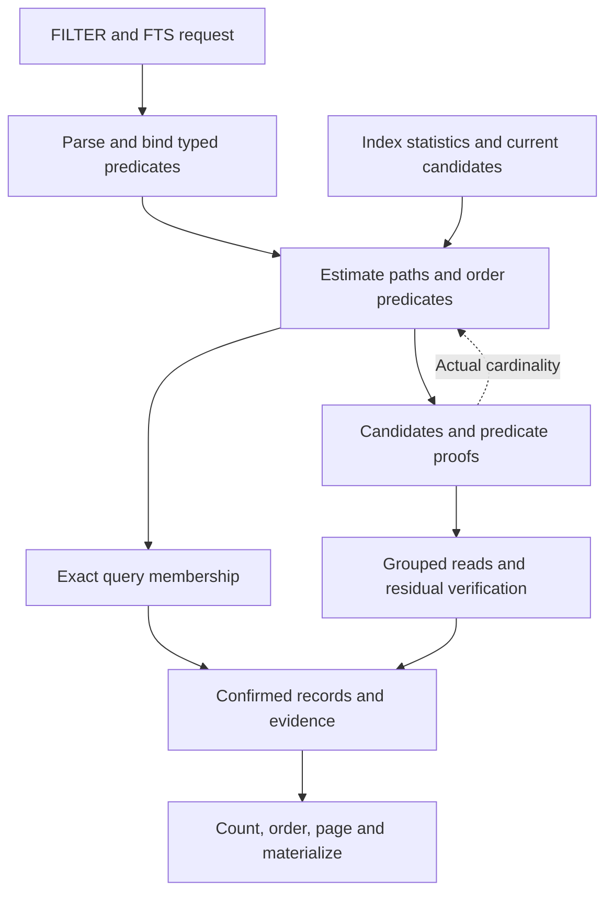
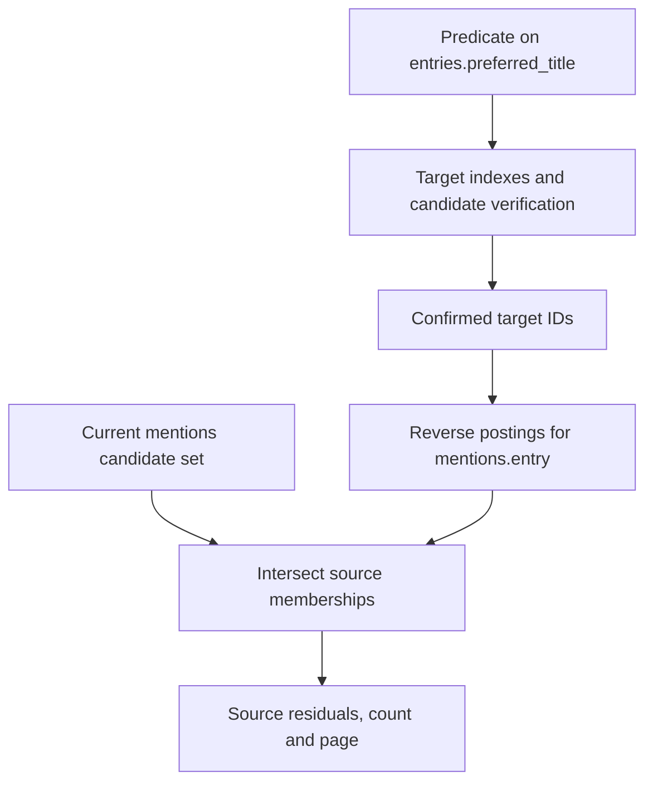

# Objekte: typed queries, regular expressions and relation traversal

## 1. Assignment and prerequisites

Extend the existing format-independent search core with:

1. Typed `$parameters`, field-to-field comparisons, date-period literals and time macros, byte-size literals, and explicit array-index selectors.
2. An inline `SORT BY` clause for structured FILTER requests, including sort-only queries, backed by the existing registered sort columns.
3. An explicit regular-expression mode for FTS.
4. A logical `ID` type, declared scalar/array relations, optimized relation traversal, outgoing references, backlinks, and a directed collection graph.

Build on the foundation implementation. Do not replace it with the archived engine or implement these features inside the JSON reader. Source adapters produce logical records; binding, planning, relations and execution belong to the engine.

Source provenance: this technical specification was originally prepared against `fix/core-foundation-correctness` at `92cdb92b19200cb0005af23b66aeb3cd1b514c4b`. A GitHub inspection on 2026-11-06 found `development/local-file-search-core` at `156fe5bc440791dd361d82e7f0f7935c50820f46`, 22 commits ahead of that foundation revision. The distinct `fix/parallel-index-construction` branch was at `a47d78acfb9d83e26b498ae1aa3564cf6547aaa3`, eight commits ahead of the development branch. This inspection establishes ancestry, not that the unfinished parallel-index branch has passed its final verification. The coordinator must recheck the refs, working-tree cleanliness, relevant reports and validation status immediately before pinning an implementation base. Prefer the validated development head; include the separate parallel-index work only after its acceptance and explicit integration. Never silently base this assignment on the historical revision or on unvalidated concurrent work.

Read repository instructions, the foundation implementation guide, and current development reports. Finish or explicitly resolve outstanding foundation correctness checks before activating dependent features. The inspected foundation progress checklist is not itself evidence that final verification has finished. Preserve malformed-record status, unavailable-data semantics, custom exact scanners, grouped source access, posting-value counts, ICU ordering, and immutable generation ownership.

The previous exclusions of these requested query features are superseded. Runtime updates, watchers, arbitrary recursive graph queries, new production source formats, SQL, user-defined expression execution, network APIs, automatic joined-record expansion, and source-change-during-read checks remain outside scope.

Commit each independently reviewable step with its tests; push each completed commit when the configured remote is available. Do not force-push, merge automatically, reset unrelated work, or accumulate the implementation into one final commit. All intermediate exposed behavior must remain coherent.

### 1.1 Mandatory execution model

Execute this assignment as **a coordinator and independent coding workers using Git worktrees**, with Codex subagents for bounded research, tests, compatibility review and other nonoverlapping subtasks. A subagent is a context, not a filesystem boundary: two writing agents in one worktree can overwrite each other's edits. Assign **one primary writing agent per worktree**. Use no more than three concurrent writing workers initially; change that limit only after observing useful throughput and local CPU, memory and disk contention. Create worktrees only at the pinned base or an explicitly approved integration checkpoint. **All Git worktrees for this assignment must be placed directly under `/home/simon/source/`. Never create worktrees under `/tmp`, `/var/tmp`, or other temporary directories, including for subagents, tests, or retries.**

The coordinator owns task dependencies, shared-interface decisions, repository-wide integration, change review, performance evidence and this task document. Workers own their scoped branches and their tests. Workers must not modify another worktree, shared Git references, the main working directory or files reserved for another worker without an approved interface change. Do not let an agent merge work into `development/local-file-search-core` or `master`; reviewed integration is performed separately and only when explicitly authorized. Section 12 is the operative worktree/subagent assignment and integration protocol; it replaces the earlier serial-only commit schedule, **not** the technical contracts in Sections 2–11.

## 2. Current source architecture and planner

### 2.1 JSON is an adapter, but remains in the core crate

At the inspected revision:

- `crates/core/src/source.rs`: `SourceReader` interface, `SourceRegistry::builtin`, `JsonReader`, `JsonLinesReader`, JSON deserialization and projected parsing. `JsonReader` implements `SourceReader` around line 468; JSONL around line 508. The registry installs them under `json` and `jsonl` around line 270.
- `crates/core/src/record_preparation.rs`: shared reader invocation, validation/conversion, text finalization and payload preparation.
- `crates/core/src/source_access.rs`: query-scoped bounded file handles and range windows.
- `crates/core/src/run.rs`: generic candidate verification and execution orchestration.

Thus JSON is a registered built-in adapter, not a separate plugin crate. Generic predicate evaluation is shared engine code. Keep that boundary; do not introduce JSON-specific implementations of parameters, relations, regex or typed literals. Adapter extraction may be moved into a cohesive submodule if useful, but a packaging migration is not required by this assignment.

### 2.2 What the planner currently does

`crates/core/src/executor.rs` is the principal access-path planner. It compares metadata/direct-ID lookup, typed postings, dictionary evaluation, compatible sort columns, raw/custom bigrams, and scanner fallback. Its cost model combines lookup work, estimated output size and estimated source work.

AND planning is greedy and re-estimates remaining choices against the shrinking input set. OR planning orders branches and can avoid membership work for already proven hits when evidence requirements allow. Exact proofs accompany candidates; approximate candidates are never complemented as if exact.

`run.rs::prepare_residual` orders remaining checks by estimated cost and acceptance/rejection probability. `run.rs::search_impl` also compares FTS-first versus FILTER-first execution; `try_stored_order_page` supports bounded ordered traversal when count is not requested. The prepared cache in `prepared.rs` stores bound queries, not an exhaustive catalogue of physical plans. The verified cache can bypass membership execution entirely.

This is a useful heuristic, cost-based single-collection planner. It does not yet have a join optimizer, correlation statistics, a general search over alternative join orders, or parameter-sensitive physical-plan reuse. Several estimates use constants and collection averages. Build on its existing choices and proofs rather than describing it as a database-grade optimizer already.

One current limitation must be corrected: `plan_expr_restricted` falls back to scanning the entire input when any record in a collection lacks logical data. Partition logical and raw-fallback domains, retain safe index planning for the logical domain, and combine results using the existing unavailable-data semantics. One broken record must not disable structured indexes for all healthy records. Metadata-only predicates should remain inventory-evaluable where possible.

Conceptual execution on a verified-result cache miss:



### 2.3 Responsibility map for this implementation

| Responsibility | Current location / suggested cohesive extension |
|---|---|
| AST, lexer and syntax | `query.rs`; extract lexer/parser modules if the file becomes unwieldy |
| Inline sorting grammar and request normalization | `query.rs`, `QueryOptions.sort` and `workload.rs::SortField`; reuse `sorting.rs`, `run.rs` and registered sort columns |
| Logical values and typed paths | `model.rs`, `path_repr.rs` |
| Schema binding, comparisons and reference evaluation | `reference.rs`; separate production binding from the reference evaluator deliberately |
| Prepared query reuse and execution values | `prepared.rs` |
| Access-path selection and proofs | `executor.rs`; relation planning may become `planner/relation.rs` |
| Verification, scheduling and ordered pages | `run.rs`, `record_preparation.rs`, `source_access.rs` |
| Typed posting keys, ranges and counts | `posting.rs`, `posting_values.rs` |
| Literal/regex bigram candidate extraction | `bigram.rs`, with a focused `regex_query.rs` module |
| ID resolution and relationship ownership | `repository.rs`, `inventory.rs`, proposed `relation.rs` |
| Snapshot and cache compatibility | `storage.rs`, `verified.rs`, `prepared.rs` |

Keep current algorithms when sound. Do not put every new case into `run.rs` or `reference.rs` merely because those files already exist.

## 3. Common query representation and contracts

Replace the literal-only right side of `Term` with a typed operand representation. A suitable conceptual model is:

```text
Operand = Field(FieldExpression)
        | Literal(TypedLiteral)
        | Parameter(ParameterId)
        | TemporalMacro(MacroId)

PathStep = Field(FieldName) | ArrayIndex(u32) | EachElement

BoundPathStep = ObjectField(FieldId)
              | ArrayIndex(u32)
              | EachElement(ScopeId)
              | ForwardRelation(RelationId)
              | BacklinkRelation(RelationId)
```

Keep source spans for diagnostics. Type and cardinality information belong to bound operands. Resolve field names, indexes, relation hops, target collections, parameter slots and custom bindings before record iteration.

Distinguish reusable query shape from execution-bound values. A prepared template may contain parameter slots and macro nodes. An execution binding supplies validated values, one frozen clock instant, resolved periods and compiled text matchers. Physical planning then uses the actual bound values and current candidate domain.

Use structural, typed cache keys. Parameters, regex mode/options, resolved temporal boundaries, source and target generations, relation declarations and binding versions must not be hidden behind a display string or omitted from membership identity. Sharing a query template across values is allowed; sharing a verified answer across different values is not.

Preserve existing precedence, parentheses, AND/OR/NOT, PocketBase-style quantifiers and metadata prefixes. Do not merge FILTER and FTS into one ambiguous language.

### 3.1 Structured FILTER `SORT BY` clause

**Observed baseline:** At `development/local-file-search-core` (`156fe5bc440791dd361d82e7f0f7935c50820f46`), structured FILTER is parsed by `query.rs::parse_filter` into a `FilterExpr` without ordering syntax. Sorting is already implemented separately as `QueryOptions.sort: Vec<SortField>` (`field`, `descending`), with registered scalar sort columns in `sorting.rs`, ICU4X collation, stable identity tie-breaking, precomputed single-field order and bounded top-k execution. `repository.rs::validate_sort` rejects unregistered and incompatible cross-collection sort fields. **Extend the query syntax, not the sorting engine.** Recheck the actual implementation at the pinned base before editing.

Accept one optional top-level ordering clause at the end of the existing FILTER input, as well as a sort-only request:

```text
structured_filter := [ boolean_expression ] [ sort_clause ]
sort_clause       := "SORT" "BY" sort_item ("," sort_item)*
sort_item         := sortable_field [ "ASC" | "DESC" ]
```

Recognize `SORT`, `BY`, `ASC` and `DESC` case-insensitively only in their syntactic positions; do not reserve these words inside quoted strings, bracket-quoted keys or ordinary field names. The default direction is `ASC`. The clause is legal once, only at the outermost level, and must consume the remainder of the input. Reject empty clauses, duplicate sort fields, unknown directions and trailing tokens with source-position diagnostics. The FILTER Boolean operators retain their current precedence. Do not interpret `SORT BY` inside ordinary FTS literals or regex patterns.

Examples (field availability depends on selected collection configuration):

```text
year >= 1800 SORT BY year DESC
preferred_title ~ 'Hymn' SORT BY year DESC, preferred_title ASC
SORT BY preferred_title ASC
@file.size >= 1MiB SORT BY @file.size DESC
['sort'].value = 'SORT BY' SORT BY preferred_title
```

Parsing and request integration:

- Provide a dedicated structured-request parser returning the optional `FilterExpr` and optional ordering specification; keep `parse_filter` available for predicate-only callers, or preserve its API through a clearly documented wrapper. Do not attach ordering to a Boolean AST term or let it participate in AND/OR/NOT.
- Normalize the inline ordering into the existing `QueryOptions.sort` representation before binding/planning. Keep the existing programmatic `QueryOptions.sort` and benchmark manifest `sort` entries compatible. If both an inline `SORT BY` clause and an independent nonempty sort option are provided, reject the ambiguous request explicitly; do not silently override, concatenate or reorder them.
- Accept `SORT BY` alone with no predicate (`filter = None` after parsing), including when independent FTS input is present. Support `--filter '... SORT BY ...'` and the sort-only CLI form. Preserve the independent FTS input and all existing positional request flags (`--limit`, `--offset`, COUNT, return mode and evidence).
- Resolve paths through the same field-path parser and schema/configuration binding as the existing sorting API. Require a registered, compatible **scalar sort column** in every selected collection, including metadata paths only when configured. This addition does **not** imply on-demand sorting of arbitrary unregistered fields: report `sort field is not registered` or another precise preparation error instead of silently introducing an unbounded source scan or building a fresh sort index at query time. Document the registration requirement in the CLI and query grammar.
- Reject multivalued/array/object paths without an explicitly supported scalar reduction, unsupported positional selectors, related-field/backlink sorting, field modifiers without a compatible registered sort definition, and sort keys supplied through `$parameters`. Relation traversal may be used in FILTER predicates, but is **not** automatically valid for sorting. If a future compatible related-field sort column already exists, it may be used only with validated singular semantics; otherwise retain the Section 9.2 exclusion.
- Preserve configured ICU collation and typed order, direction per key, the existing null/missing/fallback ordering behavior, cross-collection compatibility checks, and deterministic collection-plus-record-ID tie-breakers. Newly introduced typed ID values must not acquire accidental case folding; if an ID sort column is supported, compare canonical IDs by a documented exact order.
- Reuse the existing stored-order fast path for a compatible single-key page without COUNT, and the existing bounded top-k path for selective/multi-key requests. Do not sort the full returned payload in memory when sort columns and bounded record-slot rankings suffice. Continue distinguishing complete membership from ordered pages in the verified-result cache: sorting must not change the membership proof, but every cached ordered page must be keyed by its normalized sort fields, directions and applicable collation/configuration versions. Any required cache incompatibility must be applied in the same implementation commit.
- Include the normalized ordering, chosen ordered-scan/top-k path, and registered-column reasons in EXPLAIN; unsupported fields must fail before expensive source reads.

**Acceptance:** Inline and independent options produce identical ordered record IDs, COUNT, pages, evidence and payloads on registered fields; both execution paths and the independent reference scanner agree. Test zero/multiple sort keys, ASC/DESC/default, equal-key ties, null/missing/raw fallback, Unicode collation, mixed collections, deep offsets, warm/disabled caches, snapshots, sort-only FILTER, combined FTS+FILTER, field names containing `sort`/`by`, quoted `SORT BY` strings, duplicate/conflicting clauses and unsupported fields. Keep the existing 150 Musenalm workload queries unchanged; add focused sorting cases to the separate feature workload.

## 4. Typed parameters

Support parameters wherever a value operand is legal, for example:

```text
year >= $minimum_year && published = $published
entry = $entry_id
created >= $start && created < $end
```

Parameters are supplied separately from query text through the Rust request and existing CLI input facilities. Use logical typed values or an explicit parameter declaration plus checked deserialization. JSON input alone cannot distinguish a string, date, timestamp, Unix seconds and ID; the caller or a unique declared field context must provide that distinction.

Required behavior:

- Never interpolate parameters into query strings or reparsed syntax. A string containing quotes, operators or `$other` is still a value.
- Missing parameters, incompatible types, incompatible uses of the same parameter, invalid temporal values and overflow are preparation errors before source reads. Permit unused supplied values, and document that they have no effect on result keys.
- Infer a type only when all uses give one compatible interpretation. Ambiguous parameters on unhinted paths require an explicit type or retain their supplied logical type; do not guess dates and IDs from spelling.
- Preserve distinct `Date`, `Datetime`, `Unixtime`, `ID`, number, Boolean, null and homogeneous-array types. Array parameters use only operators whose existing semantics accept them; do not silently invent an IN operator or splice an array into multiple predicates.
- A parameter must not select a field, collection, operator or custom binding name. It binds data, not query structure.
- Parameterized regex accepts a complete pattern value in the explicit regex input mode. Substring interpolation into a regex pattern is not part of this feature.
- Bound values drive lookup ranges, selectivity and relation planning. Reuse parsing/binding structure without retaining a physical plan that is only appropriate for the previous parameter value.

Use stable parameter slots so lookup does not allocate or consult a string map per record. Keep parameter values immutable during one execution.

## 5. Field operands and explicit array selection

### 5.1 Field-to-field comparisons

Support both field and value operands while preserving quoted strings:

```text
price > minimum_price
published_at >= created_at
title:lower = alternate_title:lower
@file.size > declared_size
items[0].quantity > items[0].minimum_quantity
```

An unquoted valid field path on the right is a field operand. Quoted text remains a literal. Type-check both operands after modifiers and relation traversal. Do not lexically compare dates, coerce arbitrary strings to numbers, or compare a date to Unix seconds merely because both have an ordering.

Use the same equality/range/contains semantics as equivalent literal comparisons. For a field-valued contains pattern, preserve existing FILTER wildcard rules explicitly; FTS regex remains a separate mode. A custom binding must declare support for dynamic binary comparison or be rejected for that use. Do not call a literal parser on a different field value inside every record loop.

Prepare both input paths and their union of required projections. Decode a source record once. A comparison of two varying fields is normally a residual predicate; separate marginal posting sets do not establish their per-record relationship. Reuse trustworthy resident typed values if already available and cheaper, but do not add a dense column store just for this feature.

### 5.2 Array selectors and occurrence identity

Support zero-based integer selectors, including nested combinations:

```text
contributors[0] = $person_id
entries[2].title ~ 'Hymn'
matrix[1][2] > 10
items[*].price <= items[*].maximum_price
['literal.key'][0] = 'value'
```

`[0]` is an array position; `['0']` is an object key. Preserve explicit `[*]` as a real path step rather than erasing it. Keep existing implicit array traversal compatible. Negative indexes, slices, fractional indexes and overflow are preparation errors in this scope.

Out-of-range positions behave as missing, not null. Their `:exists` and `:null` behavior follows existing missing semantics. A statically impossible selector on a declared scalar is a binding error; on an unhinted runtime value it follows the existing path/type mismatch contract. No indexing operation may panic.

Retain occurrence identity when one predicate reads multiple fields through a shared array. `items[*].price <= items[*].maximum_price` compares values belonging to the same item; it must not form a Cartesian product or pair unrelated positions. A scalar can broadcast within a matching scope. If both operands traverse independent multivalued branches with no defined pairing, reject the comparison clearly and require explicit indexes. Do not silently zip by vector position after flattening.

Apply the term's existing universal/default or existential quantifier to the resulting comparisons. Retain existing empty-array semantics and distinguish no selected value from an unavailable record. Preserve occurrence information without allocating a large product of candidate value pairs; borrowed iterators or small bounded selection buffers are preferable.

An ordinary value posting does not encode array position. It may supply a conservative restriction for a positional equality but cannot prove the position. Keep a positional residual unless an existing compatible index contains the necessary positional information. The same rule applies to relations inside arrays and to array-derived lengths.

## 6. Temporal periods, macros and byte-size literals

### 6.1 Date-period syntax and representation

Reuse the useful archived syntax from `deprecated/crates/core/src/json_filter/temporal.rs` and `parser.rs`, with new typed binding and tests. Do not copy hand-written calendar arithmetic without justification; prefer the existing `time` dependency for validated calendar construction and checked arithmetic.

Support unquoted period literals:

```text
issued = 2026-11
issued = 2026-11-06
created = 2026-11-06T14:30Z
created = 2026-11-06T14:30:15.250+01:00
```

A period spans the precision written: calendar month, calendar day, minute, second or fractional-second unit. Use half-open bounds `[start, end)`. A bare `2026` remains a number; do not make numeric literals contextually become years. Date-only periods use calendar-date bounds for `Date` fields and UTC calendar boundaries when bound to instant-like fields. Time-bearing literals require `Z` or an explicit numeric offset; normalize instants without losing precision.

Keep quoted string/date binding behavior compatible. A typed `Datetime` parameter is an exact instant, not automatically a one-second period. `Date`, `Datetime` and `Unixtime` remain distinct stored types. A temporal-period operand is a query construct and does not require a new stored field type.

For an eligible temporal value `x` and a period `[a,b)`, define:

| Operator | Meaning |
|---|---|
| `=` | `a <= x && x < b` |
| `!=` | `x < a || x >= b` |
| `<` | `x < a` |
| `<=` | `x < b` |
| `>` | `x >= b` |
| `>=` | `x >= a` |

Reject contains/regex operations on periods. Preserve null, missing and unavailable-data rules before applying these comparisons. Do not turn period inequality into a complement over records whose temporal value is unavailable.

Lower eligible scalar comparisons to bounded posting/sort-column operations. For multivalued fields, preserve one element as the witness for both interval boundaries: intersecting records with any value above `a` and any value below `b` is not proof that one value lies inside the period. Retain a combined range evaluator or scanner residual when necessary.

For `Unixtime`, derive integer-second bounds exactly from instant bounds, including negative epochs and fractional endpoints. Do not truncate both bounds or round a query instant to the stored precision. Date fields reject time-of-day literals rather than silently discarding their time component. Bound overflow and unsupported precision are explicit preparation errors.

### 6.2 Time macros and cache identity

Provide one execution clock context. Freeze it before resolving source and relation-target predicates; never call the clock once per record, collection or relation hop. Allow an injected clock in tests and programmatic execution.

Use UTC calendar semantics initially, matching the archived implementation. Explicit timestamp offsets remain supported. Do not depend on the machine's local timezone. Named-timezone calendars and DST-aware local macros are a separate future extension.

Support the archived useful names: `@now`, `@yesterday`, `@tomorrow`, `@todayStart`, `@todayEnd`, `@monthStart`, `@monthEnd`, `@yearStart`, `@yearEnd`, and numeric components `@second`, `@minute`, `@hour`, `@weekday`, `@day`, `@month`, `@year`. Document their exact meanings. Preserve the archived meaning of `@yesterday`/`@tomorrow` as the frozen instant minus/plus 24 hours; they are not calendar-day periods. Weekday retains the documented Sunday-zero convention.

Also provide explicit period-valued `@today`, `@thisMonth` and `@thisYear`. This permits `issued = @today` without encoding end-of-day precision. Boundary `*End` macros, if retained for compatibility, are the final representable nanosecond before the next boundary; internally prefer the next exclusive boundary for period operations. Do not assume Date or Unixtime has nanosecond storage precision.

Metadata roots such as `@file.modified` remain distinct from zero-argument macro names. Reject unknown macros at binding. Snapshot storage does not freeze the current time indefinitely.

Cache identity uses resolved typed values/bounds, not merely `@now` or `@today`. A query template can be reused across midnight; a result for yesterday's resolved period cannot. Freeze the same clock across pages only when the caller reuses an explicit execution context; otherwise each new query invocation gets its own context.

### 6.3 Byte-size literals

Support case-sensitive `B`, `KB`, `MB`, `GB`, `TB` and `KiB`, `MiB`, `GiB`, `TiB` suffixes:

```text
@file.size >= 1MiB
@record.byte_length < 2.5KB
declared_size = 1536B
```

Decimal units use powers of 1,000; binary units use powers of 1,024. Parse decimal coefficients with checked integer/rational arithmetic, not floating-point multiplication. Require an exact nonnegative whole-byte result within the documented integer range; reject `0.1B`, overflow, unknown units and misleading lowercase spellings.

A size literal explicitly denotes a number of bytes and lowers to an integer numeric value. It may compare with numeric byte-count fields and size metadata; it does not introduce a new stored type or convert date/Unix-time fields. Do not infer physical units for every numeric field. Equivalent byte counts have equal bound values and result-cache identity.

## 7. Regular-expression FTS

### 7.1 Explicit mode and dependency

Extend FTS input with an explicit mode, conceptually `Literal` or `Regex { pattern, options }`. Existing FTS remains literal substring matching. Never reinterpret a literal containing punctuation or `/.../` as regex automatically. The existing CLI must expose a clear mutually exclusive regex option; no combined SQL-like query language is required.

Use Rust's maintained `regex` implementation and, for candidate extraction, compatible `regex-syntax` HIR facilities. Select versions compatible with the workspace toolchain and lock them normally. Do not introduce a backtracking engine, PCRE lookarounds or backreferences for this task. Engine syntax and unsupported constructs must be documented and reported as preparation errors.

Compile once per execution-bound pattern/options/representation and reuse the matcher. Configure explicit pattern-length, nesting, compiled-size and extraction-expansion limits. Do not truncate patterns or silently omit alternatives when a limit is reached. Use Boolean matching when only membership/evidence is requested; capture extraction and replacement APIs are outside scope.

### 7.2 Representation and verification semantics

Regex runs over the selected registered text representation. Each existing text segment is an independent haystack: matches and anchors do not cross field or array-element boundaries. A raw fallback range is its source-text haystack under the foundation's decoding contract. Default Unicode behavior and supported flags are explicit. Test multiline and dot-matches-newline separately.

Never run a whole regex pattern through a binding's ordinary literal transformer. Lowercasing, stripping punctuation or removing spaces from regex syntax can change operators and character classes. A binding must expose the compatible text representation or explicitly support preparing a regex evaluator. If it cannot, reject that binding/mode combination; do not silently switch to another representation.

Selected logical-field regex cannot treat broken raw source as that logical field. Preserve unavailable-data rules, statuses and evidence. Reuse shared source access and decode a record no more than necessary. Avoid copying transformed text when the binding can provide a borrowed representation; do not split a haystack into arbitrary chunks in a way that changes matches.

### 7.3 Safe bigram restriction

Regex support must work without a useful gram. A conservative full/restricted scan is the correct fallback. Extract necessary literal conditions from the parsed regex, not by stripping punctuation from its source string.

A safe candidate algebra is:

- A mandatory literal contributes compatible bigram candidates when sufficiently long and covered.
- Concatenation can intersect necessary conditions of its mandatory parts, without claiming order or adjacency that the regex does not establish.
- Alternation unions branch candidates. An unrestricted branch makes the union unrestricted.
- A repetition with minimum zero cannot require its child's grams. Positive minimum repetition may reuse a sound child condition.
- Empty matches, assertions and unbounded character alternatives contribute unrestricted conditions unless a stronger restriction is proven.

For example, `foo.*bar` may intersect candidates for `foo` and `bar`; `foo|bar` must union them; `(?:foo)?bar` cannot require `foo`; `.*` has no useful mandatory gram. Extractor limits must weaken to unrestricted candidates, not drop a branch.

HIR literal extraction is an optimization input, not proof that the whole regex matched. Anchors, word boundaries, repetition, ordering and segment locality still require exact verification. Unicode case-insensitive classes and custom transformations require particular care: do not use case-sensitive grams for a pattern that can match other forms. Expand only bounded complete alternatives, use a demonstrably compatible folded index, or decline filtering.

Keep candidate work bounded and costed. Do not build a bitmap for thousands of alternatives when a restricted scan is cheaper. Add reasons for absent or rejected regex prefilters to EXPLAIN.

Required property: for generated patterns/haystacks in the supported test subset, every actual regex match is in the candidate set. Exercise both alphabets, short strings, optional/empty branches, flags, anchors, Unicode folds, raw fallback text and custom representations.

## 8. ID fields and relation declarations

### 8.1 Logical ID type

Add `LogicalType::Id` and a corresponding logical value and posting-key variant. IDs are opaque, case-sensitive identifiers, not necessarily UUIDs or numbers. Use the existing canonical record-ID rules and preserve exact spelling; do not lowercase or parse integer-looking IDs. Do not conflate generated internal record identity with a user-supplied target ID.

An ID field without a relation is an opaque identifier. A relation declaration supplies its target collection. Record IDs are resolved in that collection's namespace. ID equality and inequality, including existing array quantifiers, are supported; substring operations and arithmetic are not implicit ID operations. Posting-value enumeration must preserve the ID type rather than merging ID and string keys.

Source adapters normally read IDs as strings; declared logical type conversion makes them IDs before indexing. Unhinted strings remain strings. Serialization to ordinary JSON may encode the value as a string while the logical API retains the type. Typed parameters can supply IDs directly; existing quoted-ID query syntax may bind contextually to an ID field.

Integrate record identity deliberately: identity comparisons on `@record.id` should bind to the ID representation, while existing explicitly requested textual metadata views such as `@record.id:lower` retain their established query behavior and produce a string operand. Such a view never changes canonical identity or relation resolution. Update direct-ID lookup guards, metadata FTS, prepared keys and tests together; do not reintroduce the earlier case-folded ID shortcut defect. Ordinary relation ID fields do not gain implicit case folding.

Preserve the reader's declared text coverage when string-valued fields become typed IDs. If a field's textual identifier previously contributed to the configured extracted-text representation, its typed conversion must not silently remove it. Treat that as representation/extraction policy, separate from allowing string operators on the ID logical type. Unscoped FTS never dereferences an ID merely because its spelling is searchable.

Array ID fields remain homogeneous and obey configured field/element nullability. Duplicate occurrences may be present in source arrays: preserve source order and positions for selectors, but deduplicate record membership in postings and backlinks.

### 8.2 Relation configuration

Represent relations in format-independent collection/schema definitions. Example intent:

```text
mentions.entry          : ID        -> entries
entries.contributors    : Array<ID> -> people
people.organization     : ID        -> organizations
mentions.entry backlink alias in entries: mentions
```

A relation has a stable identity, source collection and field path, target collection, declared cardinality, and optional reverse alias. Prefer the existing schema adapter's `x-relation.collection` convention if applicable, but translate it into generic definitions; core execution must not inspect JSON Schema annotations. Support relations on ID array elements and in nested logical objects, with explicit array scopes.

Reject undeclared target collections, conflicting declarations, wrong source types and ambiguous aliases during configuration. Do not infer relations because values happen to equal another collection's IDs. A relation cannot simultaneously be an embedded object of a different interpretation.

`entry` by itself refers to the stored ID. `entry.preferred_title` traverses only because `entry` is declared to reference a collection. At a nonrelation object, dot traversal remains ordinary object navigation. A plain ID without a relation cannot be dereferenced.

### 8.3 Missing and malformed targets

Retain valid source IDs even when their target is absent. Record unresolved-reference diagnostics separately from parser status: a valid source does not become malformed JSON because an external record is missing.

Distinguish missing/null relation fields, empty ID arrays, unresolved IDs, resolved targets with unavailable logical data, and resolved targets with an ordinary missing terminal field. Do not turn all of these into an empty target list.

Direct comparison of the source ID remains possible for a dangling relation. Traversing an unresolved or logically unavailable target yields an unavailable operand, so negation cannot manufacture a match. A missing terminal field in a valid target follows existing ordinary missing semantics.

Do not extract trustworthy outgoing references from raw fallback records. Surface their unavailable state in diagnostics/graph inspection rather than pretending their outgoing set is known empty. Preserve valid siblings in a broken source file.

## 9. Relation data structures, traversal and graph inspection

### 9.1 Build once, resolve after inventories exist

Use a two-stage construction process without parsing files twice:

1. Build file/record inventories and target ID lookup tables while parsing each source record once. Extract declared reference values and bounded occurrence metadata alongside normal postings.
2. Resolve those references in memory after all collection identities are available. Build forward access, reverse access, unresolved-reference diagnostics and the declaration graph.

This supports mutually referencing collections and self-references without imposing a topological file-reading order. Duplicate target IDs remain an identity error.

Reuse typed ID postings for `target ID -> distinct source record slots` where possible. Do not build a duplicate reverse hash table with copied ID strings for the same relation. Maintain a compact forward structure for `source slot -> referenced targets`, using collection-qualified slots and interned/shared IDs as appropriate. A CSR-like immutable layout is a useful starting point, but measure it against existing structures.

Forward source occurrences and reverse membership have different purposes. Preserve positions/occurrence paths needed by `[n]` and nested shared scopes, or retain a verification residual when the adjacency structure deliberately omits them. An unpositioned reverse posting cannot prove a positional relation predicate.

A relation declaration requires sufficient reverse access for efficient traversal even when a caller has not separately requested an ordinary value index for that field. Share that required structure with normal ID lookup and counts. Document its memory cost. Collections with no relations must not allocate per-record graph state.

Keep file-to-record ownership so a future whole-file replacement can identify all originating edges. Do not implement mutation now. Snapshot compatibility includes relation declarations, collection identities and target generations; validate forward/reverse consistency, slot bounds and unresolved references during restore.

### 9.2 FILTER paths and backlinks

Required forward examples:

```text
entry.preferred_title ~ $title
entry.year >= $year
contributors.name ?= $name
contributors[0].name = $name
contributors.organization.name ?= 'Archive'
```

Use declared relation cardinality and existing quantifiers. The current default for multivalued comparisons is universal; existential operators must remain existential. Do not silently change all relation arrays to ANY for convenience. Empty and absent relations retain their documented distinction.

Backlinks are reverse traversals through the same relation definitions and reverse postings. Provide read-only outgoing-reference and backlink functions with bounded pagination. Also permit explicitly registered reverse aliases under a reserved path root, for example within `entries`:

```text
@backlinks.mentions.title ?~ 'festival'
```

Here `mentions` is the reverse alias of the declared `mentions.entry -> entries` relation. It is not a magic pluralization rule. Resolve the alias at binding; reject collisions and unknown aliases. Keep `@backlinks` reserved so user data cannot collide with metadata/navigation syntax. Do not require a new on-disk backlink field.

Bound paths may mix objects, array indexes, forward relations and backlinks. Set a documented maximum path/hop depth and return an error when exceeded. Cycles in the collection graph are valid: an explicitly written finite path terminates after its fixed number of steps. Do not recursively expand all reachable records or enumerate all possible paths.

Selected-field FTS, including regex mode, should resolve the same typed relation paths and search terminal text on target records. Unscoped FTS continues to search the source record's configured targets; it does not automatically recurse into every relation.

Return matching source records once. COUNT and pagination count source records, not matching edges or target records. Logical output remains the source record; automatic joined payload expansion is outside scope. Preserve relation-qualified evidence and target identities when needed to explain a match, without cloning complete target payloads.

Related-field sorting is outside this assignment unless already supported by a compatible stored sort definition. Reject unsupported related sorts explicitly rather than sorting by ID or by an arbitrary first target.

### 9.3 Collection graph

Expose a read-only directed multigraph of declared collections and relations. Include stable collection/relation IDs, source field path, target collection, cardinality and reverse alias. Multiple fields connecting the same collections remain distinct edges.

Optionally report populated edge and unresolved-reference counts using precisely named metrics. A graph of declarations includes empty collections and relations with no current values; it is not merely an observed record graph.

Provide adjacency and strongly connected components/cyclic-component indicators if needed to inspect cycles. Reuse the archived `graph.rs` approach where sound. Do not enumerate all simple cycles, which can grow exponentially. Outgoing/backlink enumeration uses record relations; collection graph inspection does not open files or decode records.

## 10. Relation-aware planning

### 10.1 Use semijoins and bounded candidate domains

For `mentions.entry.preferred_title ~ 'Hymn'`, one useful plan is:



This is a semijoin: target matches restrict source membership without materializing joined records.

Support and cost at least two strategies:

- **Target-first:** evaluate a selective target predicate, verify necessary target candidates, then map matching target IDs back through reverse postings.
- **Source-restricted:** first apply cheap/selective source predicates, collect the unique targets reachable from surviving sources, then evaluate the target predicate within that restricted target domain and map back.

For multi-hop paths, apply equivalent restrictions through each declared hop. Reconsider strategy at existing planning/batch boundaries using actual candidate cardinalities. Do not issue a separate target query for every source record. Group target source reads by file and deduplicate target verification within one execution.

A source-dependent field-to-field comparison, such as `local_title = entry.preferred_title`, cannot be solved as one target predicate against a constant. Batch the distinct target reads and compare each source to its resolved target value, retaining occurrence identity. Never substitute one source's value into a target result cached for other sources.

### 10.2 Exactness, quantifiers and independent witnesses

Approximate target candidates are not confirmed source matches. They may restrict source candidates conservatively, but exactness is propagated only after all necessary target predicates and relation semantics are established.

For existential relations, an exact true target is a positive witness. For universal relations, every applicable occurrence must satisfy the predicate; mapping only positive targets backwards is insufficient. Track target true/false/unavailable results and unresolved edges, together with relation presence/emptiness, where needed.

- ANY is true with a true witness; false with only known false witnesses; otherwise unavailable when unresolved witnesses could matter.
- ALL is false with a false witness; true when all witnesses are known true, including the existing empty-array rule; otherwise unavailable.
- A missing relation field is not automatically an existing empty array.
- `?!=` evaluates existential inequality. It is not an anti-join against equality.
- Complement/anti-semijoin operations require the correct evaluable domain and unavailable-data handling.

Do not merge independently quantified terms into one target predicate unless the rewrite preserves witnesses. For example:

```text
contributors.name ?= 'Ada' && contributors.country ?= 'DE'
```

may be satisfied by two different contributors. Rewriting it as one target record satisfying both clauses changes the answer. A scalar relation, explicit index or a proven shared occurrence can permit tighter combination. Field-to-field comparison within one term uses its explicitly shared occurrence scope.

Avoid exponential expansion into disjunctive normal form or all join orders. Use a bounded set of well-defined physical alternatives. A conservative residual is preferable to an unsound optimization.

### 10.3 Statistics and work limits

Extend estimates with source count, distinct target count, fan-out, reverse degree summaries, resolved/unresolved counts, target selectivity and expected file/byte work. Use existing posting cardinalities and compact summaries; do not require a large statistical subsystem in the first implementation.

Account for target preparation/verification and reverse mapping, not just the final source count. A tiny target result with a huge reverse fan-out can still be expensive. Position-dependent relations and mixed unavailable domains must not be costed as exact constant-time membership when they require verification.

Bound intermediate target/source bitmaps, pending work, relation-hop depth and query-local target value retention. Large legitimate records or high fan-out may be expensive; return a documented resource error if configured limits are exceeded, never silently truncate matches or counts.

For a related target predicate already evaluated in the same immutable execution context, reuse exact membership/evidence as appropriate. Do not retain every target's full logical payload merely to avoid repeated queries. Where values are needed for source-dependent comparisons, retain only necessary projected values within a budget or schedule bounded batches.

### 10.4 EXPLAIN and cache boundaries

EXPLAIN must show normalized operands, types, parameter slots or bound values where requested, resolved temporal ranges, selected text mode, representation compatibility, relation hops, candidate/proof exactness, source-first versus target-first alternatives and selection reasons. Execution analysis additionally reports source and target input/output cardinalities, target parses, edges examined, reverse postings visited, file opens and avoided repeated verification.

Use typed predicate identities rather than source spans alone to identify reusable proofs after normalization and relation lowering. Rewritten temporal bounds and similar source spans in different collections must not accidentally share evidence.

Prepared-template identity includes declarations and path/binding versions. Result identity includes actual parameter values, resolved macros, regex/options and every involved collection generation. The current repository-wide immutable generation may conservatively cover all collections. Preserve that safe boundary; document the narrower dependency set for future whole-file replacement without implementing updates now.

Build and restore must retain sufficient graph and relation-index state for the same plans and answers. Never trust a restored source bitmap against a different target slot assignment.

## 11. Testing and benchmark requirements

### 11.1 Semantic tests

For every feature, provide independent expected answers and optimized-versus-forced-scan checks. Shared production comparison helpers alone are not an independent oracle. Preserve all foundation regression tests.

Required groups:

1. Parameters: every logical type; missing/conflicting bindings; null/arrays; embedded query punctuation; repeated template with different values; parameterized relation and regex inputs.
2. Paths and field operands: quoted keys versus indexes; nested arrays; out-of-range selectors; numeric/date/ID compatibility; shared-array correlation; rejected independent-array pairings; custom binary comparison capability.
3. Temporal/size: leap years, month/year boundaries, negative epochs, explicit offsets, fractional precision, periods over array values, exact integer rounding, frozen clock, midnight cache transitions, SI versus IEC units, fractional-byte rejection and overflow.
4. Regex: alternation, optional repetition, empty matches, anchors, flags, word boundaries, Unicode case handling, long patterns, extraction limits, segment boundaries, custom text bindings and raw fallback records.
5. Relations: scalar/array/nested declarations; same ID text in different collections; duplicate occurrences; empty/null/missing/dangling links; broken targets; forward/backlink equivalence; finite cyclic paths; duplicate target-ID failure; selected relation FTS; source-dependent comparisons.
6. Optimization: target-first and source-restricted plans; exact versus approximate target membership; universal/ANY/NOT semantics; independent witnesses; positional residuals; mixed logical/fallback partitions; no per-source target query.
7. Inline sorting: `SORT BY` with a FILTER, sort-only queries and FTS combinations; ascending/descending/multi-key order, registered metadata paths, deterministic tie-breaks, null/missing/fallback handling, parser keyword disambiguation, rejected unregistered/related sort paths, separate-versus-inline option parity, incompatible request options, COUNT/offset/page, snapshot and verified-cache semantics.
8. Integration: sort/count/page, all payload modes, evidence on/off, cache disabled/warm, build/restore, both alphabets, and a non-JSON test reader using the same engine features.

Use small deterministic property tests for conservative regex candidates, parameter substitution equivalence through typed ASTs, array occurrence pairing, relation semijoin parity, forward/reverse consistency and snapshot round trips. Save seeds and minimized fixtures for failures. Existing jq checks cover only the applicable valid-JSON subset; add an independently specified small relation evaluator that ignores indexes.

Do not silently convert broken/unavailable data to false before applying negation. Include cases where metadata OR branches legitimately select broken source records while relation/field operands remain unavailable.

### 11.2 Resource assertions

Use deterministic counters to establish one-time matcher preparation, no repeated registry resolution per record, bounded source handles and payloads, one necessary target decode per shared evaluation when within the declared reuse scope, and no source reads for resident graph inspection/backlinks.

Test a large number of sources pointing to a small target set, high fan-out arrays, several records per target file, deep pages, and an otherwise healthy collection containing one fallback record. Verify both correct answers and retained use of healthy-domain indexes. Do not use flaky millisecond limits as unit-test assertions.

### 11.3 Measurement protocol

Reuse an applicable recorded current-state baseline after checking code revision, corpus/schema, hardware/compiler, workers, alphabets, cache sizes, payload modes and timing boundaries. The earlier `final-084623a19b` results do not automatically represent the newer foundation head. Run a new baseline only if no compatible current-state recording exists, and record the reason.

Keep the existing 150 Musenalm queries unchanged. Do not create another 150-query regression suite or rerun the entire workload after every commit. Run focused tests/measurements during implementation, then a mandatory final existing-workload benchmark on the final validated code: both alphabets, disabled and 64 MiB warm verified cache, established repetitions and consistent source/decoded cache settings.

Measure fresh index construction, serialization, fresh-process restore-to-ready, snapshot size, resident/peak memory, and relation edge storage. Show healthy workloads with features unused, so infrastructure overhead is visible.

Add a separate compact feature workload with fixed data and expected results: repeated parameterized queries with varying selectivity; positional and field comparisons; inline `SORT BY` (including sort-only requests, multi-key order, deep pages, cached ordering and existing-option parity); temporal ranges; regex with useful versus absent grams; target-first and source-restricted relations; shared targets; dangling links; backlinks; and mixed regex/parameter/relation predicates. Measure compilation/binding, candidate selection, source/target verification and materialization separately where useful.

Print and save all final per-query times, raw samples, expected-result checks, plans/counters and environment metadata. Report absolute timings first, percentages second. Identify genuine millisecond regressions separately from microsecond variation. Investigate material overhead; do not claim success solely because the cached total is small.

## 12. Parallel implementation: worktrees, subagents, dependencies and commits

This section is an **execution specification for the coordinating Codex agent**, not a request for all features to be implemented in one session. Keep Sections 2–11 authoritative. Assign work that can compile and be verified independently; do not manufacture parallelism by splitting a single interface migration across conflicting branches.

### 12.1 Coordinator and worker responsibilities

**Coordinator — integration worktree only**

- Verify the newest suitable foundation revision, repository instructions (`docs/development/code-guidelines.md`), `implement.md`, the current implementation and benchmark reports. Record the exact base commit and report provenance. The checked branch names and SHAs in Section 1 are observations, not permanent selection of a moving ref.
- Establish shared contracts before spawning writing workers: typed operand/path ownership, inline `SORT BY` normalization into the existing `QueryOptions.sort` and its explicit-option conflict rule, `LogicalType::Id` and ID-to-string text-coverage policy, full-text `Literal`/`Regex` input modes, relation declaration identifiers, three-valued/unavailable results, versioned snapshot/cache identities, and the CLI/public request extension points. Record signatures and invariants, not speculative large interfaces.
- Maintain a task ledger with `ready`, `in progress`, `ready for review`, `integrated`, `blocked` and `complete` states; dependencies refer to **reviewed integration checkpoints**, not merely workers reporting done.
- Own final integration of shared `run.rs`, `executor.rs`, `repository.rs`, request entry points, `Cargo.lock`, model/snapshot version bumps and the final benchmark harness when several branches require the same file. A worker may make minimal compiling modifications to these files on its own branch; it must report them explicitly for conflict review.
- Review each worker's commits, compare with the agreed contracts, check the acceptance evidence, and propose a merge order. **Do not merge automatically**. Merge to the dedicated integration branch only when the user has authorized the integration, and never merge to development or master without separate authorization.
- Start dependent agents from the newly reviewed integration commit, not from a stale branch or from a partially cherry-picked implementation. Preserve an accurate base and evidence trail.

**Writing worker — exactly one independently writable worktree**

- Read this entire specification and the scoped assignment. Confirm base SHA, owned modules, acceptance criteria, and restrictions before editing.
- Use Codex subagents for independent read-only source investigations, test-case design, benchmark interpretation and review. If subagents edit tests, assign distinct new test files and serialize changes to common files. Subagents in the same worktree are **not** isolated from one another.
- Make each committed step compile, retain existing behavior, include focused regression tests, and preserve the repository's Rust formatting conventions. Apply `cargo fmt --all`, `python3 scripts/format-rust-spacing.py`, `cargo test --workspace`, `cargo clippy --workspace --all-targets` and `git diff --check` at the checkpoints specified by repository instructions; report advisory warnings rather than claiming a warning-free run.
- Commit and push independently reviewable changes on the worker branch when a configured remote is available. Never force-push or rewrite published history; do not merge other workers' branches on your own authority.
- Return an implementation handoff with branch, base SHA, ordered commit SHAs, changed files, focused tests and outputs, known limitations, snapshot/cache effects, benchmark evidence when applicable, and exact integration dependencies. Do not claim an acceptance gate passed without recorded evidence.

**Concurrency constraint:** start with three writing workers, each in a separate worktree. Additional read-only subagents are permitted within available resources. Three concurrent `cargo` builds may multiply target-directory space and compete for CPU, I/O and page cache; prefer separate `target/` directories for correctness and account for compilation resource contention when benchmarking. Run comparative performance measurements without competing builds or indexing workloads.

### 12.2 Safe initial worktree setup

Do not perform these commands blindly on a working tree containing uncommitted user changes. The coordinator first inspects `git status`, branches and worktrees, checks whether `fix/parallel-index-construction` has been independently validated and integrated, and selects a **fixed commit SHA**. In the example below, the development branch is the provisional source; replace it if a newer explicitly validated integration base exists. The commands assume the original repository is `/home/simon/source/objekte` and create every additional checkout as a direct child of `/home/simon/source`; do not substitute a temporary directory.

```bash
# Run from the existing Objekte repository root.
cd /home/simon/source/objekte
WORKTREE_ROOT=/home/simon/source
git fetch origin
BASE_COMMIT=$(git rev-parse origin/development/local-file-search-core)
git status --short
git worktree list

# A separate integration branch, never an implicit update to master/development.
git worktree add -b integration/typed-query-extensions \
  "$WORKTREE_ROOT/objekte-typed-query-integration" "$BASE_COMMIT"
```

The coordinator commits preparation and the logical-domain planner prerequisite (tasks `TASK-00` and `TASK-01`) on the integration branch, verifies them, and records the resulting **gate commit**. Only then create the first three writable worker worktrees, all from the **same immutable gate commit**:

```bash
GATE_COMMIT=$(git -C "$WORKTREE_ROOT/objekte-typed-query-integration" rev-parse HEAD)

git worktree add -b feature/typed-query-operands \
  "$WORKTREE_ROOT/objekte-typed-query-operands" "$GATE_COMMIT"

git worktree add -b feature/full-text-regular-expressions \
  "$WORKTREE_ROOT/objekte-full-text-regular-expressions" "$GATE_COMMIT"

git worktree add -b feature/relation-indexing \
  "$WORKTREE_ROOT/objekte-relation-indexing" "$GATE_COMMIT"
```

Start **one separate Codex CLI session** in each worker directory (or use Codex's worktree-capable UI if available). The coordinating agent may run subagents for planning/review, but must not assume that launching a native subagent creates a new directory or branch. The three first-wave workers operate independently. Do not create all later branches from the initial gate: later tasks require the accepted outputs of earlier work.

For subsequent waves, use the same `git worktree add -b <task-branch> /home/simon/source/<task-directory> <approved-integration-sha>` procedure **after** prerequisites have been integrated. All worker and subagent worktree paths must remain under `/home/simon/source/`. Never rebase a published worker branch merely to make the dependency diagram look linear. If a worker must be restarted, preserve its committed work, create a fresh branch from a reviewed checkpoint, and document the adaptation. Remove completed worktrees only after their work is safely integrated or intentionally archived.

### 12.3 Dependency graph and dispatch order

```mermaid
flowchart TD
    A["TASK-00: Base, contracts and evidence"] --> B["TASK-01: Logical/fallback planner domains"]
    B --> C["TASK-02: Typed operands, SORT BY, parameters, paths and field comparisons"]
    B --> D["TASK-04: Regular-expression FTS"]
    B --> E["TASK-05: ID types and relation index construction"]
    C --> F["TASK-03: Temporal, macros and byte sizes"]
    C --> G["TASK-06: Forward and backlink query evaluation"]
    E --> G
    E --> H["TASK-08: Relation and collection-graph inspection"]
    G --> I["TASK-07: Relation-aware semijoin planning"]
    F --> J["TASK-09: Cross-feature integration and independent oracles"]
    D --> J
    H --> J
    I --> J
    J --> K["TASK-10: Final benchmark and verification report"]
```



**Wave 0 — serial, narrow prerequisite.** Coordinator executes `TASK-00` then `TASK-01`. Fix the mixed logical/raw-fallback planner domain before adding optimizations that rely on its exactness. Freeze shared API contracts and run foundation checks. The historical foundation report at `92cdb92b19` already records its verification, but the current base and subsequent changes still require checking.

**Wave 1 — three concurrent coding workers.** Assign `TASK-02` (query operands and inline sorting), `TASK-04` (regex FTS) and `TASK-05` (ID plus relation storage) to the three worktrees above. All start from the same verified gate. Worker A and Worker C must coordinate type/API changes through the coordinator: Worker A owns operand/binder types; Worker C owns the persistent logical ID model. Worker B owns regex matching and conservative candidate extraction. Each branch must remain independently compiling and testable. Workers may propose narrow integration hooks, but must not independently resolve conflicting edits to `run.rs`/`executor.rs`.

**Wave 2 — up to three concurrent writing workers after reviewed integration.** Once `TASK-02` (including `S1`) has integrated, launch `TASK-03` for temporal/size features. Once **both** `TASK-02` and `TASK-05` have integrated, launch `TASK-06` for relation path evaluation. Once `TASK-05` has integrated, `TASK-08` may build the resident inspection API. These tasks may overlap; give each its own worktree created from a compatible integration checkpoint. Their completion order does not need to match their task numbers.

**Wave 3 — relation planning and convergence.** `TASK-07` begins after the relation path evaluator (`TASK-06`) has passed its semantic tests and integrated. Keep planning and evidence exactness in the same owner branch. Resolve all remaining hooks from regex, temporal and relation workers; then execute `TASK-09` and, finally, `TASK-10`. Only final code receives the complete fixed Musenalm benchmark workload.

At most three writing workers are active at once. If a prerequisite is blocked, continue only genuinely independent work. Do not create a worker solely to keep the slot occupied. The coordinator's review and integration are not extra concurrent writes to a worker's source tree.

### 12.4 Work-package assignments and completion criteria

#### TASK-00 — Foundation verification and interface contract

**Owner:** coordinator, `integration/typed-query-extensions`. **Milestone:** commit 1.

Inspect source and reports, pin the baseline revision, verify the repository's current foundation checks, record benchmark comparability, assign shared module ownership and document the API contracts. Reconcile the separate parallel-index branch explicitly; do not incorporate it by assumption. Resolve which components own `LogicalType::Id`, bound operands, text representations and relation declarations. Add compact fixtures describing missing/null/unavailable semantics and representative interface examples where appropriate.

**Exit:** documented SHA, clean recorded integration working tree, passing applicable foundation checks, baseline decision, agreed signatures and first-wave worktree creation instructions. No feature implementation is necessary in this task.

#### TASK-01 — Preserve planner indexing for healthy logical records

**Owner:** coordinator, integration branch. **Milestone:** commit 2. **Primary files:** `executor.rs`, `run.rs`, mixed-domain tests.

Split valid logical and raw-fallback domains in restricted planning. A malformed record must not disable healthy-domain postings. Preserve exact/approximate proof boundaries, Boolean NOT/OR semantics, metadata-only inventory predicates and fallback records with unavailable logical operands. Use current `plan_expr_restricted` and related execution paths; do not refactor unrelated costing.

**Exit:** independently expected answers, optimized-versus-forced-scan parity, a mixed fixture that demonstrably uses the healthy-domain index, and no regression in fallback evidence/status. This verified commit is the first-wave base.

#### TASK-02 — Typed operand and path language

**Owner:** query worker, `feature/typed-query-operands`. **Milestones:** original commits 3–6 plus new sorting commit `S1` after the shared syntax/AST change. **Primary files:** `query.rs`, `path_repr.rs`, `prepared.rs`, `reference.rs`; add dedicated parser/binder modules and separate test files as useful.

Implement typed operands, source spans, reusable parameter slots, stable bound identities, explicit integer array selectors and `[*]`, scope-preserving field-to-field comparisons, type inference/rejection, and checked request/CLI parameter transport. Also implement the complete Section 3.1 top-level `SORT BY` syntax, sort-only parsing, conversion to existing `QueryOptions.sort`, explicit-option collision checks and focused parity tests. Preserve all pre-existing query syntax, quantifiers and data-unavailability rules. Treat two related array paths as correlated only with a proved common scope. Do not add an `IN` operator or turn unquoted string literals into implicit fields.

**Dependency boundary:** use the generic logical value/type API agreed at `TASK-00`; do not independently add the persistent ID variant to `model.rs` or redesign storage. If contextual ID binding needs the later `TASK-05` variant, keep a narrow typed hook and report the remaining integration test rather than inventing a duplicate ID type. The coordinator reconciles shared public request and `run.rs` hooks.

**Exit:** old syntax parity; inline/external sort equivalence with registered columns; deterministic multi-key/count/page results; rejection of ambiguous and unregistered sorts; parameter safety and cache-key tests; positional and occurrence identity tests; non-JSON reader compatibility; full workspace checks. Original commits 3, 4, 5 and 6 and the new `S1` sorting commit remain individually reviewable.

#### TASK-03 — Temporal ranges, frozen execution time and byte units

**Owner:** temporal worker, branch `feature/temporal-query-operands`, created from reviewed `TASK-02`. **Milestones:** commits 7–9. **Primary files:** new `temporal_query.rs`, `clock_context.rs`, `byte_size_literal.rs` (names may follow existing conventions), narrowly scoped parser/binder hooks and independent tests.

Add half-open precision-aware period operands and checked calendar arithmetic; the complete archived macro set plus `@today`, `@thisMonth` and `@thisYear`; one injected/frozen execution clock; exact Unix-second lowerings; SI/IEC byte-size parsing with whole-byte validation. Reuse `time` and the shared bound operand representation. Preserve per-element interval witnesses and result-key identity across midnight. Avoid a second parser or unrelated query AST redesign.

**Exit:** leap/offset/negative-epoch/fractional-period tests; array-posting parity; frozen-clock and cross-midnight cache cases; checked sizes, overflow and invalid units; separate committed steps and full workspace checks.

#### TASK-04 — Explicit regular-expression full-text search

**Owner:** full-text worker, `feature/full-text-regular-expressions`. **Milestones:** commits 10–11. **Primary files:** new `regex_query.rs`, `bigram.rs`, dedicated tests; only small explicit request/FTS wiring edits in shared files.

Implement opt-in `Literal`/`Regex` mode, bounded compilation and regex-syntax literal extraction, segment-scoped Boolean matching, representation/binding compatibility, raw-fallback verification, and conservative bigram restrictions. Regex extraction must be a sound necessary condition, not final proof. Inability to extract a safe condition falls back to a scanner; flags and Unicode folding must never introduce false negatives. Keep literal FTS behavior unchanged.

**Parallel boundary:** Worker B owns regex-specific helpers and tests, not general FILTER grammar, relational evaluators or the planner's general cost framework. Supply typed mode/options and any needed `run.rs`/`executor.rs` integration as a small, named change that the coordinator can review against the other branches.

**Exit:** regex-oracle and candidate-superset properties for both alphabets, limits and unsupported-syntax errors, selected/raw/custom representation tests, useful/absent-gram plans, snapshot/cache compatibility and full workspace checks.

#### TASK-05 — Logical ID type, relation declarations and resident indexes

**Owner:** relation-index worker, `feature/relation-indexing`. **Milestones:** commits 12–13. **Primary files:** `model.rs`, `posting.rs`, `posting_values.rs`, `inventory.rs`, `repository.rs`, `storage.rs`, new `relation.rs` and their tests.

Implement an opaque, case-sensitive logical ID type and posting keys; source ID-text coverage preservation; namespace-safe target identity; relation configuration; two-stage extraction/resolution after inventories are built; compact forward adjacency, reverse membership, missing-target diagnostics and immutable snapshot restore. Respect source occurrence positions or explicitly retain required residuals. No per-record graph allocations for collections without relations; no second parse of every file solely to build edges. Keep generated record identity distinct from declared target references.

**Parallel boundary:** Worker C owns the shared model/storage representation for IDs. Worker A owns query operand syntax and binding. Do not implement relation FILTER paths or semijoin planner changes in this task. Expose a stable, documented read-only relation accessor that later evaluator and inspector workers can consume. Reserve cross-cutting `run.rs` changes for the coordinator.

**Exit:** scalar/array/nested links, duplicate targets, empty/missing/null/dangling references, file-to-edge provenance, forward/reverse consistency, compact memory evidence, build/restore parity, invalidation/version checks, all workspace tests. Report every on-disk and cache-format change at the commit that introduced it.

#### TASK-06 — Forward and backlink predicate evaluation

**Owner:** relation-query worker, `feature/relation-traversal`, created after reviewed `TASK-02` **and** `TASK-05`. **Milestone:** commit 14. **Primary files:** dedicated relation evaluation/binding modules plus focused `reference.rs`/query/FTS bridges.

Bind finite forward/backlink path steps, reserved aliases, nested array occurrence scopes and explicit positional traversal. Implement independent reference scanning with correct source return identity and source record counts. Preserve universal/default and existential quantifier truth across empty, missing, unresolved and unavailable targets; avoid global false conversion before NOT. Support relation-qualified selected FTS, including regex where available; a regex dependency does not justify merging unrelated regex code into this branch. Reject unsupported related-field sorting.

**Exit:** independently specified relation evaluator, optimized-versus-scan parity, cyclic finite paths, independent existential witnesses, `?!=` semantics, field-to-field source/target comparisons, selected relation FTS, evidence and cache correctness. No unreviewed semijoin optimizer in this task.

#### TASK-07 — Costed semijoin paths and bounded relation execution

**Owner:** relation-planner worker, `performance/relation-semijoins`, created from a checkpoint containing `TASK-06`. **Milestone:** commit 15. **Primary files:** `executor.rs`, `run.rs`, optional `planner/relation.rs` and focused performance/correctness tests.

Implement target-first and source-restricted strategies, bounded multi-hop propagation, deduplicated target reads, reverse fan-out costing, exact/approximate proofs, source/target cardinality counters and EXPLAIN. Preserve source-dependent comparisons and occurrence identity; never replace universal predicates or independently quantified terms with an unsound positive-witness semijoin. Bound intermediate storage and issue explicit resource errors rather than truncating results.

**Exit:** expected answers from the independent `TASK-06` evaluator; forced strategy parity; both strategies demonstrably chosen on appropriate fixtures; actual target parse and edge-visit counters; correctness of NOT/ANY/ALL and fallback partitions; no per-source target query; workspace and focused benchmark checks.

#### TASK-08 — Resident references, backlinks and collection graph

**Owner:** relation-inspection worker, `feature/relation-inspection`, created after reviewed `TASK-05`. **Milestone:** commit 16. **Primary files:** new `relation_inspection.rs`, `collection_graph.rs` if justified, independent tests and minimal public API hooks.

Expose bounded, read-only outgoing/backlink enumeration and declaration graph inspection including distinct relation edges, cardinalities, aliases and optional SCC/cyclic-component indicators. Use existing adjacency and reverse postings; do not add a duplicate relation index. Graph inspection must neither decode records nor open source files. Preserve unavailable-source diagnostics. Coordinate `repository.rs` entry-point edits with the coordinator; `TASK-06` and `TASK-07` may continue independently.

**Exit:** stable pagination and identities, zero-source-read assertions, empty-collection graph entries, parallel relation edges, finite cycles and persisted/restored equivalence.

#### TASK-09 — Cross-feature integration and independent verification

**Owner:** coordinator, integration worktree. **Milestone:** commit 17. **Prerequisites:** tasks `03`, `04`, `07`, `08` reviewed and integrated.

Complete shared API and cache/source-generation reconciliation; test inline `SORT BY` combined with parameters, temporal predicates and regex FTS, as well as sort-only and cross-collection requests; test parameters plus regex, temporal periods plus relation fields, occurrence-bound related comparisons, selected relation FTS, both gram alphabets, non-JSON reader, mixed malformed/healthy collections, all payload/count/page/evidence profiles, warm/disabled verified cache, snapshots and property tests. Resolve interface conflicts rather than weakening test assertions. Keep a separate relation oracle that does not use production index or semijoin functions.

**Exit:** source-independent expected results, full workspace tests/Clippy/formatting, deterministic resource counters, no unresolved integration conflicts. This produces the final code revision to benchmark.

#### TASK-10 — Final measurements, evidence and delivery

**Owner:** coordinator, integration worktree. **Milestone:** commit 18. **Prerequisite:** `TASK-09` accepted.

Apply Section 11.3 once to the final validated code. Recheck compatibility before reusing existing current-state recordings. Run the established 150 Musenalm queries, unchanged, across both alphabets, disabled and 64 MiB warm verified cache, established repetitions and recorded source/decoded-cache settings. Record all individual timings, full expected-answer checks, plans, counts, construction/restore measurements, resident and peak memory, snapshot and relation-edge cost; add the compact separate feature workload. Include accurate measured parent SHA and artifact fingerprints. Report remaining limitations and any overhead when features are unused.

**Exit:** independently reproducible report and per-query samples; no undocumented claim of a benchmark passing. If correctness changes after the report, rerun affected checks and update the measured parent rather than reusing stale results.

### 12.5 Retained 18-commit milestones plus sorting milestone S1

The 18 original identifiers retain the specification's **logical milestones**, not a mandatory global chronological commit sequence. `S1` is an additional independently reviewable sorting commit assigned to the same TASK-02 worker; it is not a new concurrent worker or worktree. Every feature branch commits its own milestones in order; independent branches may complete in parallel. Integration history may contain merge commits or additional narrowly scoped repair commits. Each milestone includes its own tests and documentation; do not defer correctness to `TASK-09`.

| Milestone | Work package | Suggested commit message | Required evidence |
|---|---|---|---|
| 1 | TASK-00 | `docs(core): record query extension contracts and baseline` | Pinned revision, accepted signatures, comparable baseline and branch disposition |
| 2 | TASK-01 | `fix(planner): preserve indexed execution for logical record partitions` | One fallback record does not disable healthy indexes; Boolean parity |
| 3 | TASK-02 | `refactor(query): represent typed operands and explicit path steps` | Old syntax unchanged, source spans, structural identities |
| S1 | TASK-02 | `feat(query): parse inline SORT BY into registered sort options` | FILTER and sort-only grammar, conflicting-option errors, existing-option parity, ordered pages, cache and EXPLAIN evidence |
| 4 | TASK-02 | `feat(query): bind typed execution parameters` | Binding/type/injection and result-cache tests |
| 5 | TASK-02 | `feat(query): preserve explicit array positions and occurrence scopes` | Selector/key distinction, nested paths, positional residual |
| 6 | TASK-02 | `feat(query): compare fields within prepared occurrence scopes` | Scalar/broadcast/shared-scope equivalence and pairing errors |
| 7 | TASK-03 | `feat(query): lower typed temporal periods to exact comparisons` | Half-open bounds, precision, array witness and posting parity |
| 8 | TASK-03 | `feat(query): resolve clock macros per execution` | Frozen clock and midnight/cache behavior |
| 9 | TASK-03 | `feat(query): parse checked byte-size literals` | SI/IEC values, exact fractions and overflow |
| 10 | TASK-04 | `feat(fts): execute prepared regular expressions` | Mode, segments, custom bindings, limits and syntax errors |
| 11 | TASK-04 | `perf(fts): restrict regex verification with conservative bigram conditions` | Candidate-superset properties and useful/absent-gram timing |
| 12 | TASK-05 | `feat(model): add typed identifier values and postings` | Conversion, equality, namespace, posting-value counts and text coverage |
| 13 | TASK-05 | `feat(relation): register collection links and build reference access` | Two-stage resolution, forward/reverse state, diagnostics and restore |
| 14 | TASK-06 | `feat(query): bind relation and backlink paths` | Independent evaluation, quantifiers, unavailable data and finite cycles |
| 15 | TASK-07 | `perf(planner): select target-first and source-restricted semijoins` | Exactness, witnesses, batching, selected FTS and work counters |
| 16 | TASK-08 | `feat(relation): expose bounded references backlinks and collection graph` | Zero-read inspection, aliases, SCCs and stable pagination |
| 17 | TASK-09 | `test(core): verify typed regex and relation feature combinations` | Independent oracles, seeded properties, caches and persistence |
| 18 | TASK-10 | `docs(bench): record query extension verification and final timings` | Final 150 queries, build/restore, memory and feature workload |

Changes to snapshot or cache compatibility occur in **the commit that first changes semantics**, even in a worker branch; the coordinator must reconcile version changes before integration. Keep every intermediate public feature coherent. In particular, do not expose relation traversal that evaluates unresolved targets or negation incorrectly just because a later milestone plans to fix it.

### 12.6 File ownership, integration checkpoints and merge discipline

Treat the following as **default source-ownership boundaries**, not authority to bypass a compilation dependency:

| Owner/task | Primary owned implementation | Shared touch points requiring review |
|---|---|---|
| Coordinator, TASK-00/01 | execution contracts, foundation planner partition, integration tests | `executor.rs`, `run.rs`, docs, `Cargo.lock` |
| Query, TASK-02 | `query.rs`, `path_repr.rs`, `prepared.rs`, `reference.rs`, new operand/binder modules, top-level sorting parser | `model.rs`, `sorting.rs`, `run.rs`, request/CLI APIs, ordering cache/EXPLAIN |
| Temporal, TASK-03 | new temporal/clock/size modules and their tests | `query.rs`, `prepared.rs`, `reference.rs`, cache keys |
| Full-text, TASK-04 | `regex_query.rs`, `bigram.rs`, regex fixtures/tests | `run.rs`, `executor.rs`, request/CLI API, `Cargo.lock` |
| Relation index, TASK-05 | `model.rs`, `posting.rs`, `posting_values.rs`, `inventory.rs`, `relation.rs`, `storage.rs` | `repository.rs`, reader extraction, snapshot/cache versions |
| Relation evaluation, TASK-06 | relation binding/evaluation helpers and tests | `reference.rs`, `run.rs`, selected FTS |
| Relation planner, TASK-07 | `planner/relation.rs` if appropriate, `executor.rs`, `run.rs` | shared proof/evidence and EXPLAIN paths |
| Relation inspection, TASK-08 | graph/inspection helpers and tests | `repository.rs` read-only public methods |
| Coordinator, TASK-09/10 | cross-feature tests, benchmarks, final reports | public APIs, versions, shared integration glue |

Before changing a shared touch point in a worker branch, document the minimal surface and notify the coordinator in the handoff. The coordinator resolves overlapping modifications in the integration worktree **after explicit approval**, not by granting two agents the same writable checkout. When practical, prefer a new focused module and a small centralized registration change over parallel editing of a monolithic function.

Integration acceptance gates:

1. **G0 — Base selected:** status/ancestry checked; suitable validated source SHA recorded; separate parallel-index branch disposition recorded; baseline and interfaces agreed. `TASK-00` complete.
2. **G1 — First-wave base:** `TASK-01` corrected and verified. All first-wave branches originate from this exact commit; record it in their handoffs.
3. **G2 — Shared language/data base:** review first-wave results and, with authorization, integrate the ID/relation storage and typed query operand changes into the dedicated integration branch; integrate regex separately after checking overlapping FTS/run changes. Confirm the combination compiles, corrects caches/versions, and passes relevant tests. `TASK-03`, `TASK-06` and `TASK-08` may start only from checkpoints containing their required antecedents. Do not wait for unrelated regex optimization to launch temporal work.
4. **G3 — Relational semantics:** once `TASK-06` passes and integrates, launch relation semijoin planning. Inspection may integrate independently. The semantics oracle remains available throughout optimization.
5. **G4 — Final validation:** complete shared integration; run `TASK-09`, then `TASK-10`. Do not run the full 150-query performance workload after each worker commit; use focused checks in worktrees and one mandatory final run.

The coordinator should propose a precise merge/cherry-pick sequence with SHA and test evidence for each change. **No automatic branch merges.** A merge into the dedicated integration branch requires user approval; a merge into development or master requires separate approval. No worker may force-push, reset unrelated changes, resolve conflicts by discarding another branch, or alter a user's unfinished work. If the integration branch changes while a worker is active, that does not retroactively change the worker's recorded base; dependent work is created from the next approved checkpoint.

### 12.7 Subagent use and handoff protocol

Each writing worker may delegate these **bounded subtasks** to native Codex subagents, if available:

- **Read-only architecture subagent:** inspect existing module contracts, list relevant source paths and report changes needed without editing.
- **Independent test-design subagent:** derive expected results from the specification and fixtures, especially missing/null/unavailable, quantifier, array-scope and regex candidate cases; do not reuse the production evaluator as the oracle.
- **Review subagent:** read the worker's completed diff, find correctness, performance, serialization and compatibility risks, and report actionable findings. Avoid making simultaneous overlapping edits.
- **Measurement subagent:** analyze recorded benchmark samples and explain absolute overhead and changed execution plans; do not run competing timed workloads while another worker compiles or indexes.

Native subagents normally share their parent's worktree unless explicitly isolated by the chosen tool. If Codex subagents are unavailable, keep the same ownership model using separate Codex CLI sessions and manual review; do not block implementation on a particular orchestration API or configuration option.

Every worker completes the following handoff in the task ledger, using actual evidence:

```text
Task identifier:
Owning branch and worktree:
Pinned base commit:
Ordered implementation commits:
Changed implementation and test paths:
Implemented behavior and deliberately excluded behavior:
Public API, cache, or snapshot changes:
Test commands and observed results:
Independent oracle / optimized-versus-scan evidence:
Measured performance, memory, and resource counters (when applicable):
Known failures, warnings, and open risks:
Shared-file edits requiring integration:
Prerequisites for the next task:
```

Task completion means **committed, reviewed and evidenced**, not simply that an agent has stopped producing output. The coordinator's last report identifies the exact measured code parent, commands, fixture fingerprints, passed checks, remaining limitations and per-requirement evidence. Corrections after measurement require appropriate reruns and a new measured revision; never retain a stale all-complete statement.

## 13. Primary references and archived implementation guidance

- Historical verified foundation source: [foundation revision](https://github.com/Simon-Martens/objekte/tree/92cdb92b19200cb0005af23b66aeb3cd1b514c4b). At the 2026-11-06 GitHub inspection, [development/local-file-search-core](https://github.com/Simon-Martens/objekte/tree/development/local-file-search-core) had advanced to `156fe5bc440791dd361d82e7f0f7935c50820f46`; [fix/parallel-index-construction](https://github.com/Simon-Martens/objekte/tree/fix/parallel-index-construction) was a distinct, eight-commit-ahead branch. Revalidate both before execution.
- Archived query syntax and temporal behavior: `deprecated/crates/core/src/json_filter/parser.rs`, `temporal.rs`, `mod.rs`.
- Archived relation work and graph inspection: `deprecated/crates/core/src/json_filter/relation.rs`, `deprecated/crates/core/src/graph.rs`. Reuse tested semantics and algorithms where compatible; do not import its document-loading strategy without measurement.
- Rust regex implementation and supported syntax: [regex documentation](https://docs.rs/regex/latest/regex/).
- Conservative literal extraction contracts and limits: [regex-syntax literal Extractor](https://docs.rs/regex-syntax/latest/regex_syntax/hir/literal/struct.Extractor.html).

Inline `SORT BY` is a newly requested extension to the FILTER language; the pre-existing sortable-field configuration is intentionally retained. The concrete syntax and execution contracts in this document are implementation requirements. Dependency documentation establishes library capabilities; it does not establish the correctness of Objekte's candidate restrictions, relation rewrites or cache identity. Those require the specified tests.
